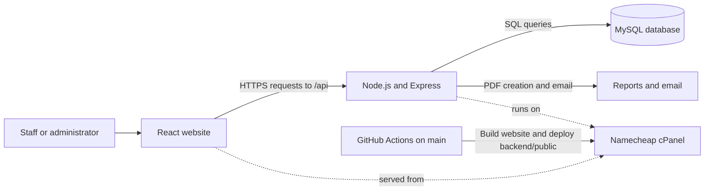

# Swiss Side Stock Management

Swiss Side is a web app for staff to track stock and operational needs across departments. Staff can record stock changes, find inventory, prepare shopping lists and view reports. Administrators can manage users and settings.

> New to the project? Start with [the plain-language guide](docs/guide.md). Developers can continue with [architecture](docs/architecture.md), [features and reports](docs/features-and-reports.md), or [local setup](docs/development.md).

## What is used

| Technology | Where it is used | In everyday terms |
| --- | --- | --- |
| JavaScript (including JSX) | `frontend/` and `backend/` | App behavior in the browser and on the server; JSX lets the browser UI be described alongside JavaScript. |
| React | `frontend/src/` | Builds the screens from reusable pieces. |
| Tailwind CSS and CSS | `frontend/src/index.css` and UI class names | Controls colors, spacing, and layout. |
| Node.js and Express | `backend/` | Runs the web server and its `/api` endpoints. |
| MySQL and SQL | `backend/src/` | Stores users, inventory, and stock history. |
| YAML | `.github/workflows/deploy.yml` | Tells GitHub Actions how to build and deploy the app. |
| JSON | `package.json` files | Lists JavaScript packages and the commands used to build or start each part. |
| Bash | `backend/scripts/backup.sh` | A small server maintenance helper. |

The browser interface is built with Vite. See [the library guide](docs/guide.md#libraries-in-plain-language) for the important packages and what they do.

## How the pieces connect

## Start here

- [Plain-language tour](docs/guide.md): what the app does, the languages and libraries, and a simple feature map.
- [Architecture](docs/architecture.md): folders, sign-in, API, database, and deployment diagrams.
- [Features and reports](docs/features-and-reports.md): inventory, reorder drafts, and how reports are assembled.
- [Local development](docs/development.md): prerequisites, environment variables, and commands.

## Important notes

- Production deployment is configured in [`.github/workflows/deploy.yml`](.github/workflows/deploy.yml). On pushes to `main`, GitHub Actions builds the frontend, copies it into `backend/public`, and deploys the backend folder to cPanel using repository secrets.
- The database is not created from a checked-in `schema.sql`. The app uses existing MySQL tables and startup migrations in `backend/src/db-migrations.js`; see the setup guide before connecting to any database.
- Keep real `.env` files and passwords out of GitHub. Use the checked-in examples as templates.
- There is no repository-level `LICENSE` file yet. A public repository without a license does not automatically grant permission to reuse its code; the owner can add a license if they intend to allow that.
