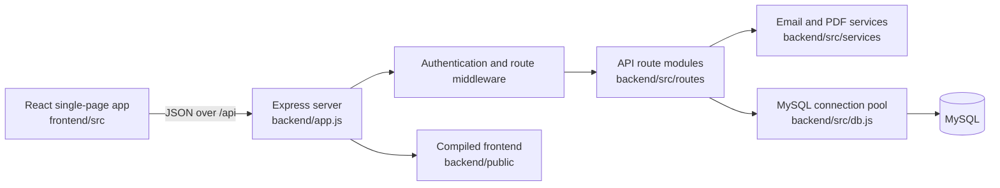
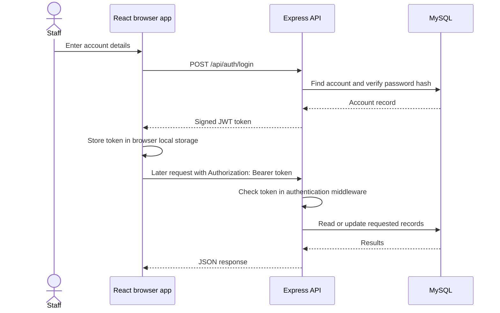
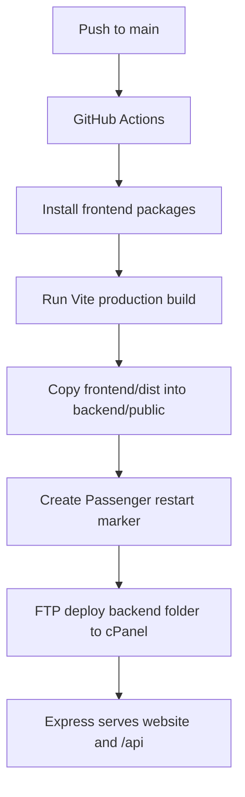

# Codebase architecture

## System overview

The browser and API are separate parts of the source, but deployment puts the compiled browser app inside the backend's `public` folder. Express serves both the website and API from the deployed application.

## Sign-in and data requests

Implementation pointers:

- `frontend/src/lib/api.js` sets the `/api` base path and attaches the token to requests.
- `frontend/src/App.jsx` checks the current user and restricts pages.
- `backend/src/routes/auth.js` handles sign-in and account-related routes.
- `backend/src/middleware/auth.js` validates the token and access.
- `backend/src/db.js` creates the MySQL connection pool.

## Folder guide

| Location | What belongs there |
| --- | --- |
| `frontend/src/pages/` | Main screens such as Dashboard, Kitchen, Needs, and Reports. |
| `frontend/src/components/` | Reusable interface pieces used by multiple pages. |
| `frontend/src/hooks/` | Reusable React behavior, including API and folder navigation helpers. |
| `frontend/src/lib/` | Shared browser utilities, including the API client. |
| `backend/src/routes/` | API endpoints organized by feature or department. |
| `backend/src/middleware/` | Request checks such as sign-in authorization. |
| `backend/src/services/` | Shared backend work such as PDF and email generation. |
| `backend/scripts/` | Database migration and maintenance utilities. |
| `backend/public/` | Built frontend files served by Express; regenerated by the GitHub deployment workflow. |
| `docs/` | Project documentation and design notes. |
| `.github/workflows/` | Automated GitHub tasks, including deployment. |

## Deployment flow

The workflow needs the `FTP_SERVER`, `FTP_USERNAME`, `FTP_PASSWORD`, and `FTP_TARGET_DIR` GitHub Actions secrets. It uses Node.js 22. The workflow, not the old versioned ZIP scripts, is the active automated deployment path.
