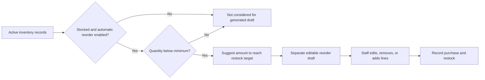
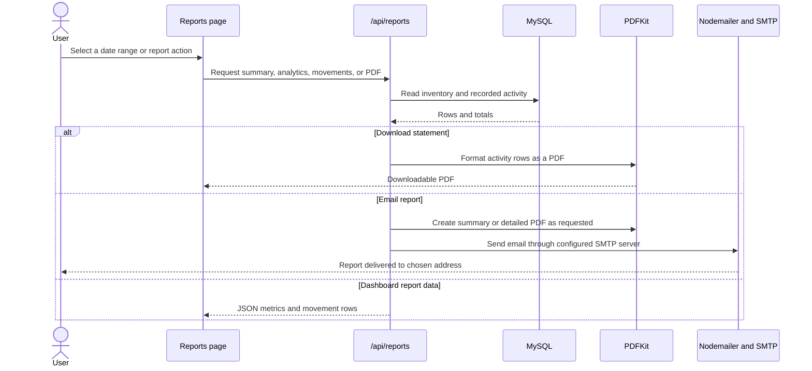

# Features and report generation

## Inventory and stock activity

The interface has department pages for Kitchen, Spa, Shop, Gym, Supplies, and Laundry, plus General Supplies and accommodation features. Inventory records can be grouped in folders. Stock movements are recorded through the department API routes and saved in MySQL. The dashboard provides cross-inventory metrics and search through `/api/dashboard`.

## Shopping lists and the generated reorder draft

The Needs screen has two distinct workflows:

- **Shopping lists** are the manual procurement lists. Staff can create and edit a list and its lines.
- **Reorder draft** is a separate draft that can be synchronized from eligible low-stock inventory. Its generated lines are editable, and staff can add a manual line. Recording an item as purchased marks it and can restock the linked item.

Item type and auto-reorder settings are part of inventory configuration. The generated draft only includes items that are active, stocked, explicitly enabled for automatic reorder, and below their configured minimum. The suggested amount aims to bring stock up to the configured restock target. This is a draft for staff review, not an order sent to a supplier.

## What reports generate

The Reports screen offers time periods, analytics and movement data, a downloadable operations statement, and email delivery of a summary or detailed report. PDF creation uses PDFKit in `backend/src/services/reportPdf.js` and `backend/src/routes/reports.js`; email delivery uses Nodemailer through `backend/src/services/email.js`.

### Coverage detail

The detailed activity query in `backend/src/routes/reports.js` reads transaction tables for Kitchen, Spa, Shop, Gym, Supplies, and Laundry. General Supplies uses a shared `transactions` route/table and is not currently part of that same detailed activity query. Check the individual report endpoint before assuming every report includes every feature area.

The system can only report activity that was recorded in its database. It does not scan receipts or infer purchases from external sources.
