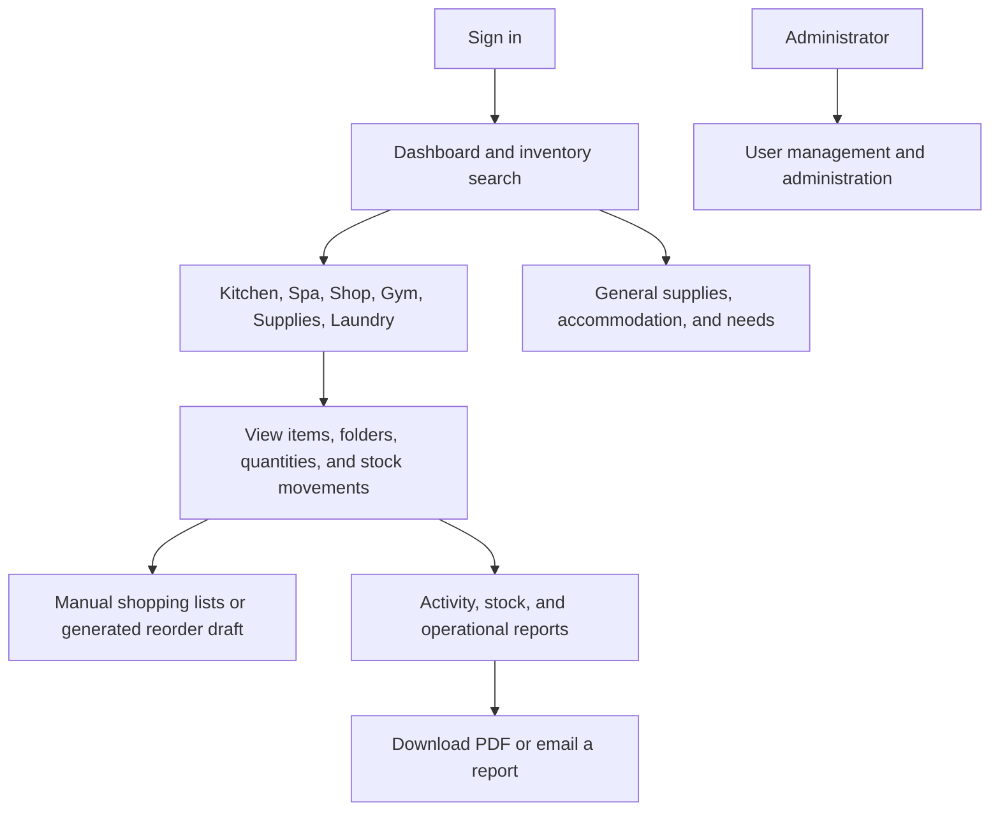

# Swiss Side, explained simply

This guide is for someone who wants to understand the app without already knowing how to program.

## What does the app do?

It gives staff one place to manage stock and operational needs across departments. They can browse and search inventory, record stock coming in or going out, see low-stock information, prepare manual shopping lists, create a separate reorder draft from eligible low-stock items, and review activity reports. Administrators also manage users and other settings.

## A simple map

## Languages and files

- **JavaScript** is the main language. It tells the browser and server what to do.
- **JSX** is JavaScript with a convenient way to describe screen elements. The frontend files ending in `.jsx` use it.
- **CSS** styles the interface. Tailwind CSS adds many small style classes directly to the UI markup; `frontend/src/index.css` holds shared styles.
- **SQL** is the language the server uses to read and change MySQL records. The database schema is not represented by one complete SQL file in this repository.
- **YAML** configures the GitHub deployment workflow.
- **JSON** lists packages and commands in `package.json` files.
- **Bash** appears in a server maintenance helper. It is not a main application language.

## Libraries in plain language

| Library | What it does |
| --- | --- |
| React | Builds the screens and reusable UI parts. |
| Vite | Starts the frontend while developers work and creates the optimized website files for deployment. |
| Tailwind CSS | Provides ready-to-use styling classes for layout and appearance. |
| React Router | Connects page URLs such as `/dashboard` and `/reports` to the right screen. |
| Axios | Sends requests from the browser to the server API. |
| Lucide React | Supplies the small icons used in the interface. |
| React Hot Toast | Shows short success and error messages. |
| Express | Defines the server and its API routes. |
| mysql2 | Connects Node.js to MySQL and runs SQL queries. |
| bcryptjs | Checks passwords against securely stored password hashes. |
| jsonwebtoken | Creates and checks the sign-in token used for protected requests. |
| express-rate-limit | Limits repeated requests on sensitive routes such as sign-in. |
| multer | Handles uploaded files such as profile pictures. |
| node-cache | Keeps short-lived server-side cached values. |
| PDFKit | Produces report and shopping-list PDF files. |
| Nodemailer | Sends reports and other messages through the configured mail server. |
| dotenv | Loads local server settings from a `.env` file. |
| CORS and compression | Control which browser origins may call the API and compress server responses. |

## What happens when a person signs in?

1. The browser sends the email and password to the Express API.
2. The server checks the user record in MySQL and verifies the password hash.
3. If valid, the server returns a signed token.
4. The browser stores that token in local storage and sends it with later API requests.
5. The server checks the token before returning protected data.

See the [architecture page](architecture.md#sign-in-and-data-requests) for the diagram and implementation file locations.
